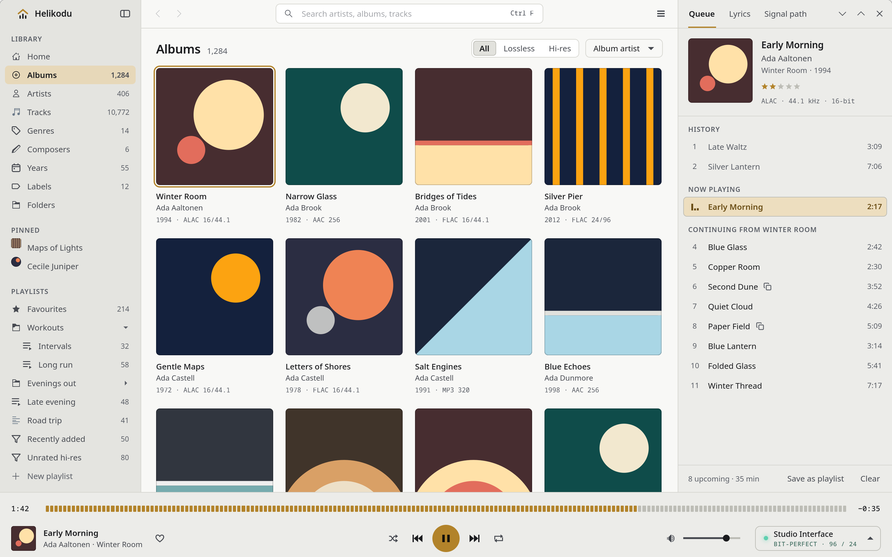
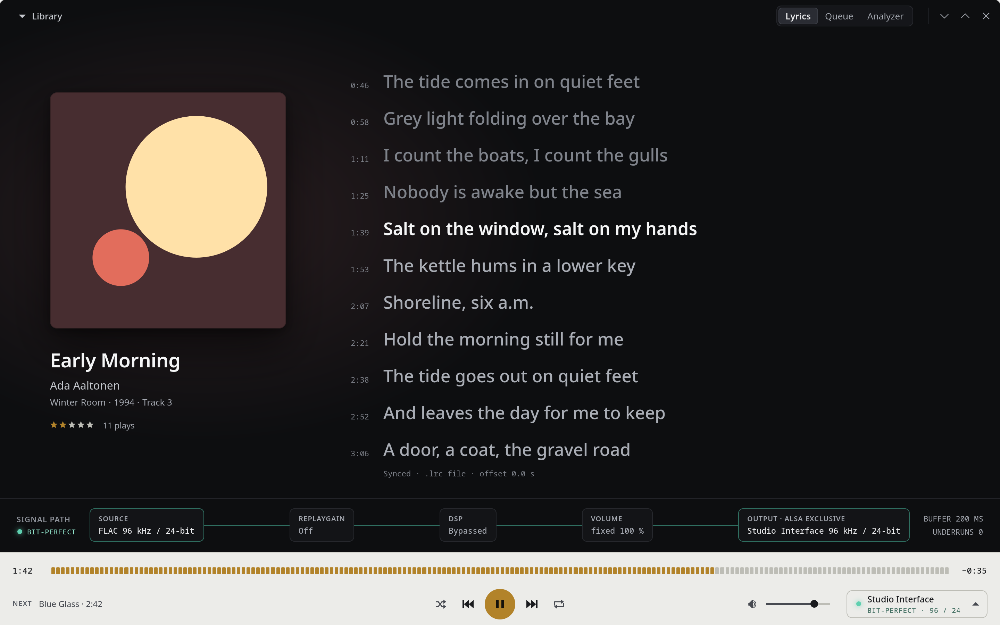
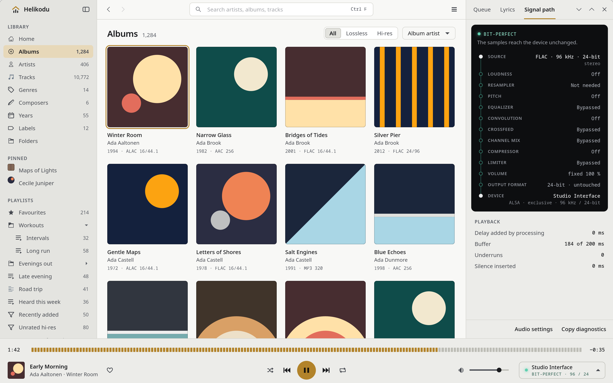
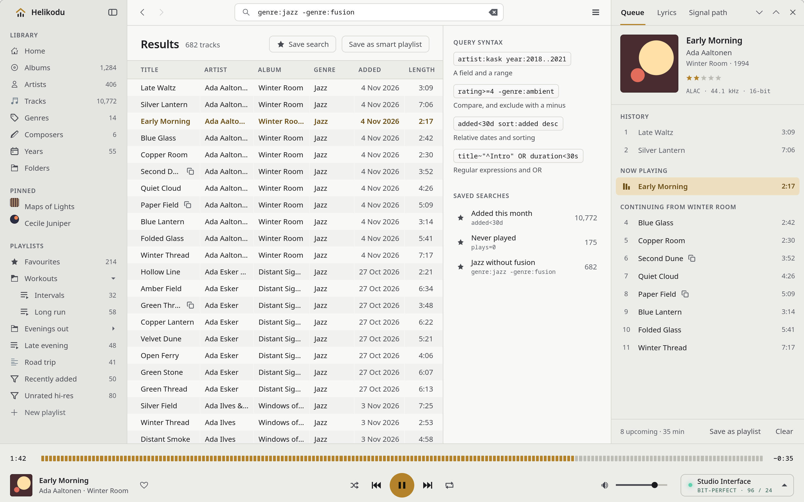
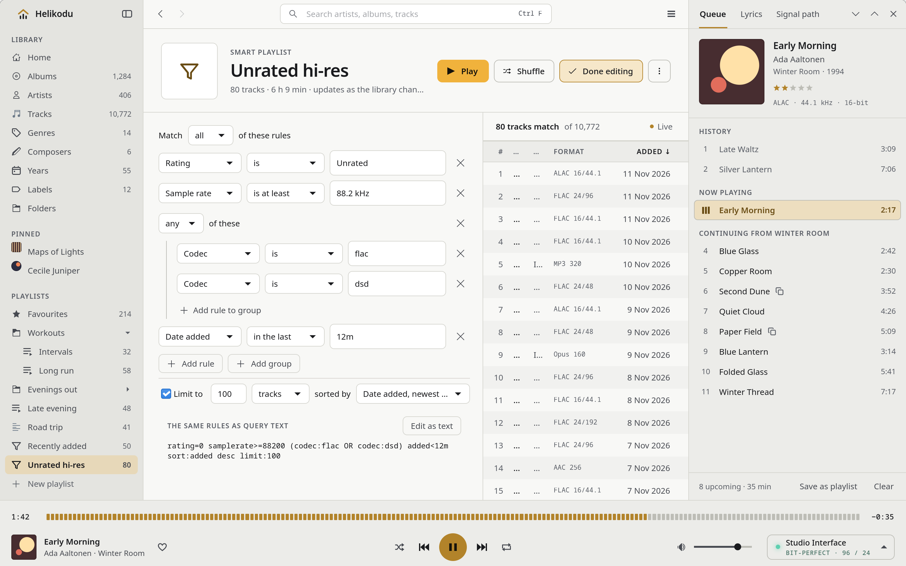

<p align="center">
  
</p>

<h1 align="center">Helikodu</h1>

<p align="center">An offline audio player and music library manager for Linux.</p>

<p align="center">
  <a href="https://sorrelfox.github.io/helikodu/">Website</a> ·
  <a href="https://sorrelfox.github.io/helikodu/guide/">User guide</a> ·
  <a href="https://github.com/sorrelfox/helikodu/releases">Download</a> ·
  <a href="CHANGELOG.md">Release notes</a>
</p>

<p align="center">
  <picture>
    <source media="(prefers-color-scheme: dark)" srcset="docs/site/assets/shots/albums-dark.webp">
    
  </picture>
</p>

Helikodu plays the music you own, from your own computer. It plays practically every audio format, plays it correctly, keeps up with very large collections, and never connects to the internet. It is written in Rust, with a GTK 4 interface of its own design.

The name is Estonian: *heli* means "sound" and *kodu* means "home". Say it HE-li-ko-du.

## What it does

- **Plays practically every audio format.** FLAC, ALAC, WAV, MP3, AAC, Opus, Vorbis, DSD, tracker modules, game music, SID tunes, MIDI and many more, with CUE sheets and chapters, and the sound track of video files. Helikodu never shows video.
- **Plays it correctly.** Gapless joins, seeking to the exact frame, crossfades, and bit-perfect output where the hardware allows it.
- **You choose the output.** PipeWire, PulseAudio, ALSA or JACK, the device and the mode, shared or exclusive, switched while music plays. A signal path view shows every stage between the file and the device.
- **Sound processing when you want it.** Graphic and parametric equalizers, crossfeed, channel mixing and a true-peak limiter, and loudness normalization with ReplayGain 2.0 and EBU R128 measurement. With everything off, the samples pass untouched.
- **A library built for large collections.** 100,000 tracks and more, scanned in isolated processes and watched for changes, with play counts, ratings and playlists that survive moving and renaming your files.
- **Search with a query language.** `genre:jazz -genre:fusion`, or `added<30d sort:added desc`. The same language builds smart playlists.
- **Lyrics, history, audiobooks and play modes.** Synced lyrics from your own files, a play history you can export, chapters, shuffle by album or folder, an A-B loop and a sleep timer.
- **Careful tools for your files.** A tag editor with undo, converting, folder sync, organizing by naming patterns, a cover manager, file verification and duplicate finding.
- **At home on every desktop.** GNOME, KDE Plasma and others, on Wayland and X11, in light and dark, through freedesktop standards (MPRIS, notifications, XDG portals). The interface is in English and eleven translations: German, Spanish, French, Italian, Japanese, Korean, Dutch, Brazilian Portuguese, Russian, Ukrainian and Simplified Chinese.
- **A command-line tool.** `helikodu-cli` plays files in a terminal, works with the library and controls the running application.
- **Entirely offline.** No network code, no online services, no telemetry. This is enforced in the build and checked by an offline test audit.

<table>
  <tr>
    <td width="50%">
      <picture>
        <source media="(prefers-color-scheme: dark)" srcset="docs/site/assets/shots/now-playing-dark.webp">
        
      </picture>
    </td>
    <td width="50%">
      <picture>
        <source media="(prefers-color-scheme: dark)" srcset="docs/site/assets/shots/signal-path-dark.webp">
        
      </picture>
    </td>
  </tr>
  <tr>
    <td align="center">Now Playing, with synced lyrics</td>
    <td align="center">The signal path, bit-perfect from the file to the device</td>
  </tr>
  <tr>
    <td width="50%">
      <picture>
        <source media="(prefers-color-scheme: dark)" srcset="docs/site/assets/shots/query-dark.webp">
        
      </picture>
    </td>
    <td width="50%">
      <picture>
        <source media="(prefers-color-scheme: dark)" srcset="docs/site/assets/shots/smart-playlist-dark.webp">
        
      </picture>
    </td>
  </tr>
  <tr>
    <td align="center">Search with the query language</td>
    <td align="center">The rule builder of a smart playlist</td>
  </tr>
</table>

The [website](https://sorrelfox.github.io/helikodu/) shows every part of Helikodu with screenshots. The pictures show the built-in sample library: every album, artist and track in them is invented.

## Installing

Helikodu is published on the [Releases](https://github.com/sorrelfox/helikodu/releases) page, for every common way of installing software on Linux:

| File | What it is |
|---|---|
| `helikodu-<version>-x86_64.flatpak` | The Flatpak, for any distribution with Flatpak |
| `Helikodu-<version>-x86_64.AppImage` | One file that runs without installing |
| `helikodu-<version>-1.fc45.x86_64.rpm` | The package for Fedora 45 |
| `helikodu_<version>-1.debian13_amd64.deb`, `helikodu_<version>-1.ubuntu26.04_amd64.deb` | The packages for Debian 13 and Ubuntu 26.04 |
| `helikodu-<version>-1-x86_64.pkg.tar.zst` | The package for Arch Linux |
| `helikodu-<version>-x86_64-linux.tar.xz` | The ready-built programs, to unpack anywhere (also as `.tar.gz`) |
| `helikodu-<version>.tar.xz` | The source code, with everything needed to build it without a network |
| `SHA256SUMS` | Checksums of the files |

Every file except the Arch package also comes for 64-bit ARM computers (`aarch64`, or `arm64` for the Debian and Ubuntu packages).

The Flatpak is also published in Helikodu's own Flatpak repository, which keeps it up to date like any other Flatpak application. Open [helikodu.flatpakref](https://sorrelfox.github.io/helikodu/helikodu.flatpakref) with your software centre, or install it for your user from a terminal:

```sh
flatpak install --user --from https://sorrelfox.github.io/helikodu/helikodu.flatpakref
```

The first time, Flatpak also installs the GNOME runtime from Flathub. Helikodu then appears in the application list of your desktop, and `flatpak update` (or the software centre) brings new versions. From version 0.9.3 on, the `.flatpak` file from the Releases page adds the same repository when it is installed. The repository is signed; its public key is [`packaging/flatpak/helikodu-repo.gpg`](packaging/flatpak/helikodu-repo.gpg).

### What the Flatpak may do, and why

In the Flatpak, Helikodu has no network access at all and asks only for what its features need:

- **Your Music folder**, to read and change it: for the library, the tag editor, organizing files and cover files. Other folders are added in the settings.
- **The sound system** (PipeWire and PulseAudio), to play and to choose the output device.
- **Reserving a sound card**, so that the sound server hands it over for exclusive, bit-perfect output.
- **The login manager** (logind), to pause playback before the computer goes to sleep or the screen locks.
- **The system tray**, for the optional tray icon.

Software centres list these permissions and may rate them as potentially unsafe, as they do for most music players that manage files. Helikodu shows the same list the first time it starts, and under **About ▸ Permissions**. [docs/dev/flatpak.md](docs/dev/flatpak.md#permissions) has the technical details.

The [user guide](https://sorrelfox.github.io/helikodu/guide/) covers installing, the first run and troubleshooting.

## Building from source

### What you need

| Needed | Version | Notes |
|---|---|---|
| Rust | 1.100, pinned in `rust-toolchain.toml` | `rustup` installs the pinned version by itself. The oldest supported version is 1.98 |
| C and C++ compilers, pkg-config, clang with libclang | | libclang generates the bindings to the C libraries; the C++ compiler builds the shim for libsidplayfp |
| GTK | 4.18 or newer | |
| FFmpeg | 7.1 or newer | libavformat, libavcodec and libavutil |
| PipeWire | 1.2 or newer | |
| ALSA | | |
| JACK | | Only `jack.pc` is needed to build; `libjack` itself is loaded at run time |
| SQLite | 3.43 or newer, with FTS5 | Or the bundled copy; see the options below |
| libopenmpt | 0.6 or newer | Tracker modules |
| libgme | 0.6.2 or newer | Game music |
| libsidplayfp | 2.0 or newer | SID tunes |
| Meson, Ninja, gettext, Python 3 | Meson 1.0 or newer | Only to install |

These are the development files of each library. The PulseAudio backend speaks the protocol itself and needs none. The package lists for Debian, Ubuntu, Fedora and Arch are in [`ci/containers/`](ci/containers/).

### For development

Cargo builds and runs everything:

```sh
cargo build
cargo run -p helikodu              # the desktop application
cargo run -p helikodu -- --demo    # the same with invented sample albums, without a library
cargo xtask ci                     # every check that CI runs
```

### To install

Meson calls Cargo to build the programs in release mode and installs them with the desktop entry, the AppStream metainfo, the D-Bus service file, the icons, the translations, the manual pages and the user guide:

```sh
meson setup _build --prefix=/usr/local --buildtype=release
meson compile -C _build
meson test -C _build      # validates the desktop entry and metainfo, where the tools are installed
sudo meson install -C _build --no-rebuild   # or: meson install -C _build --destdir "$PWD/stage"
```

`--no-rebuild` keeps `sudo` from starting Cargo again as root: Cargo decides what is up to date, so Meson always runs it.

`helikodu` and `helikodu-cli` go to `<prefix>/bin` and the scan worker to `<prefix>/libexec/helikodu` (or the `helperdir` option's folder). The programs look for it beside themselves, in `../libexec/helikodu` from their own folder, and in the folder it was installed to.

The release source tarballs include every Rust dependency, so they build without network access: add `-Doffline=true` to `meson setup`. How releases are made is described in [docs/dev/releasing.md](docs/dev/releasing.md).

### Options

Meson options, given to `meson setup` as `-D<option>=<value>`:

| Option | Default | Effect |
|---|---|---|
| `offline` | `false` | Builds with `cargo --offline`. Use it with a release source tarball, whose `vendor/` folder holds every crate |
| `bundled_sqlite` | `false` | Builds the SQLite copy bundled with rusqlite instead of linking the system SQLite |
| `helperdir` | `<libexecdir>/helikodu` | The folder for the scan worker, absolute or relative to the prefix (`/usr/lib/helikodu` on Arch Linux) |

Cargo features of `helikodu` and `helikodu-cli`:

| Feature | Default | What it adds |
|---|---|---|
| `pipewire`, `alsa`, `pulseaudio`, `jack` | on | The output backends |
| `dsd` | on | The reader for DSF and DFF files |
| `openmpt`, `gme`, `sid` | on | Tracker modules, game music and SID tunes, through libopenmpt, libgme and libsidplayfp |
| `midi` | on | MIDI files, with a SoundFont |
| `vgmstream` | off | Game audio streams, through vgmstream 1.1 or newer |
| `bundled-sqlite` | off | The SQLite copy bundled with rusqlite |

To leave a feature out, build with `--no-default-features` and list the others. For example, `cargo build --release -p helikodu --no-default-features --features pipewire,alsa,pulseaudio,dsd,openmpt,gme,sid,midi` builds without JACK. Meson builds with the default features.

## Documentation

| For | Where |
|---|---|
| Users | The [user guide and FAQ](https://sorrelfox.github.io/helikodu/guide/). The same guide is installed with Helikodu and opens with F1; its source is in [`docs/user/`](docs/user/). The manual pages `helikodu(1)`, `helikodu-cli(1)` and `helikodu-scan-worker(1)` are in [`data/man/`](data/man/) |
| What changed | [CHANGELOG.md](CHANGELOG.md) |
| Contributors | [CONTRIBUTING.md](CONTRIBUTING.md), then [`docs/dev/`](docs/dev/): the architecture, the D-Bus interface, performance, fuzzing, the threat model and how releases are made |

## Repository layout

| Folder | Content |
|---|---|
| `apps/` | The programs: `helikodu` (desktop application), `helikodu-cli`, `helikodu-scan-worker` |
| `crates/` | The libraries, one folder per crate |
| `data/` | Desktop entry, AppStream metainfo, icons, D-Bus files, manual pages |
| `po/` | Translations |
| `packaging/` | The Flatpak, Fedora RPM, Debian/Ubuntu and Arch Linux packaging, built for every release (the AppImage is in `build-aux/appimage/`) |
| `docs/` | Developer and user documentation, and the website |
| `tests/` | Fixtures, test corpus recipes, system and UI tests |
| `fuzz/` | Fuzz targets |
| `ci/` | Container definitions and test environments for CI |
| `xtask/` | Developer commands (`cargo xtask <command>`) |

## Contributing

Contributions are welcome. The project uses no service other than GitHub.

- **Problems and ideas** go to the [issues](https://github.com/sorrelfox/helikodu/issues). Say which version, distribution and desktop you use.
- **Translations** are gettext files, sent as pull requests: see [po/README.md](po/README.md).
- **Code** follows [CONTRIBUTING.md](CONTRIBUTING.md), and everyone follows the [Code of Conduct](CODE_OF_CONDUCT.md).
- **Security problems** are reported privately: see [SECURITY.md](SECURITY.md).

## Licence

Helikodu is free software: you can redistribute it and/or modify it under the terms of the GNU General Public License as published by the Free Software Foundation, either version 3 of the License, or (at your option) any later version. See [LICENSE](LICENSE).

Documentation and artwork are licensed under CC-BY-SA-4.0 and the AppStream metadata under CC0-1.0. Every file states its licence through [REUSE](https://reuse.software) metadata; the licence texts are in `LICENSES/`.
