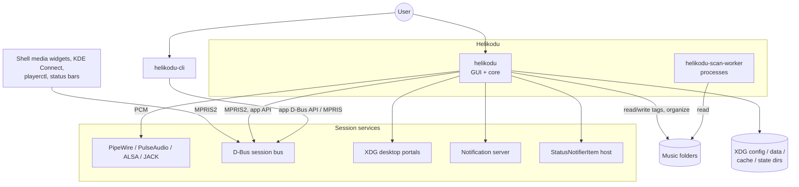
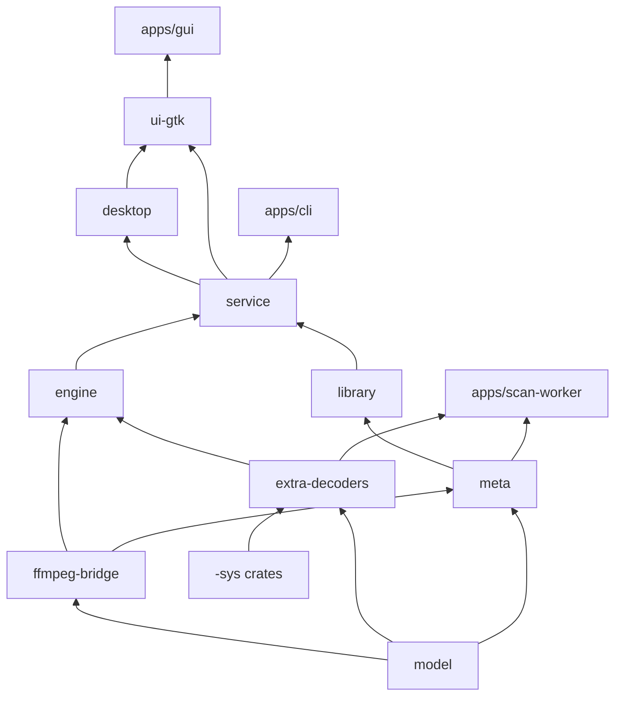
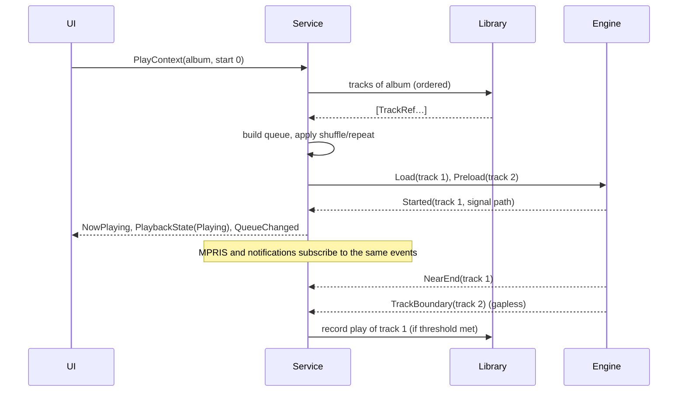

# Architecture overview

This page explains how Helikodu is put together: what it talks to, how the code is split into crates, which threads and processes run, how they communicate, where data is stored, and the rules that apply everywhere. Read it before your first larger change. The crate list and dependency rules are also in [crates/README.md](../../crates/README.md); this page adds the reasons and the runtime view.

## Design drivers

| Driver | Consequence |
|---|---|
| Audio correctness (gapless, bit-perfect, click-free) | An in-house engine that controls decoding, buffering and output directly, not a generic media framework |
| UI independence and testability | A headless core (engine, library, service) that the GUI, the CLI and D-Bus clients all use through one command/event API |
| Large libraries (hundreds of thousands of tracks) | SQLite with full-text search, lazy list models in the UI, background scanning, caches on disk |
| Hostile or broken media | Metadata extraction in separate processes; `unsafe` confined to FFI crates; fuzzing |
| Offline by construction | No network crates in the dependency graph; FFmpeg restricted to local files |
| Desktop neutrality | Integration only through freedesktop/XDG interfaces, the same on GNOME, KDE and others |
| Churn in third-party audio libraries | Decoders and outputs behind internal traits and registries |

## System context



There is no network edge in this diagram, and the dependency policy keeps it that way. Helikodu never opens a socket to the outside world, not even when a file or playlist points at a URL.

## Crates

One Cargo workspace. Libraries live in `crates/`, programs in `apps/`, developer commands in `xtask/`. Every package is named `helikodu-<folder>`.

| Crate | Kind | Responsibility |
|---|---|---|
| `model` | lib | Shared types: identifiers, audio specifications, library records, settings, commands and events. No I/O |
| `ffmpeg-bridge` | lib, `unsafe` | Safe wrapper over the FFmpeg C API: custom I/O, probing, decoding, seeking, metadata, chapters, attached pictures. Local files only |
| `openmpt-sys`, `gme-sys`, `vgmstream-sys`, `sidplayfp-sys` | lib, `unsafe` | Raw bindings, one crate per C or C++ library. No logic |
| `extra-decoders` | lib, `unsafe` | Safe decoders over those bindings, the MIDI synthesizer and the DSF/DFF reader. Each behind a Cargo feature |
| `engine` | lib | Decoder registry, render thread, DSP, crossfade, resampling, output backends, transport state machine |
| `meta` | lib | Tags, covers, CUE sheets, lyrics, playlist formats, naming templates |
| `library` | lib | Database and migrations, scanner, watcher, albums and artists, search, query language, smart playlists, statistics |
| `service` | lib | The application core: player (queue, modes, session, statistics recording), library facade, settings store, event bus |
| `desktop` | lib | MPRIS2, the application D-Bus API, notifications, portals, power inhibition, tray icon |
| `ui-gtk` | lib | The GTK 4 front end |
| `testkit` | lib, dev only | Shared test helpers: fixtures, PCM comparison, golden files |
| `apps/gui` | bin `helikodu` | Wiring only: starts the service, hands it the desktop integrations and runs the front end |
| `apps/cli` | bin `helikodu-cli` | Remote control over D-Bus, plus offline tools (scan, info, verify, convert, list outputs) that use the core directly |
| `apps/scan-worker` | bin `helikodu-scan-worker` | Isolated metadata extraction, one file at a time, over stdin/stdout |



### Dependency rules

- `ui-gtk` never uses `engine` or `library` directly; everything goes through `service`. A second front end could therefore be added without touching the core.
- `engine` knows nothing about the library; it plays media sources.
- Only `ffmpeg-bridge`, `extra-decoders` and the `-sys` crates may contain `unsafe` code. Every other crate has `#![forbid(unsafe_code)]`.
- Programs hold no domain logic. They parse arguments, wire parts together and (in the CLI) print results. Everything else lives in a library, where it can be tested.
- `testkit` is only ever a development dependency.
- No crate may depend on network, TLS or DNS crates.

`cargo xtask check-deps` and `cargo deny check` enforce these rules in CI.

## Audio engine in brief

- **Decoding.** FFmpeg is the broad decoder, used through raw bindings and our own thin safe wrapper. Long-tail formats (tracker modules, game music, SID, MIDI, DSD files) go to dedicated libraries. A registry picks the decoder: cheap signature checks first, then content probing by FFmpeg; file names are never trusted. Files with several logical tracks (subsongs, CUE sheets) appear as several library tracks.
- **Render thread.** Decodes ahead and keeps a ring buffer filled (200 ms by default). Each source is converted to 32-bit float, mapped to the output channel layout, given its track gain and resampled. Sources are joined gaplessly or crossfaded, then the DSP chain runs once on the mixed signal.
- **Output thread.** Copies from the ring buffer, applies the master volume with a short ramp (so pause and volume react at once even though DSP runs ahead), dithers, converts to the device format and hands the buffer to the backend.
- **Bit-perfect path.** When no gain, DSP, software volume or crossfade is needed and the device accepts the source format, integer samples pass through untouched. A per-track *path plan* decides this and also drives the signal-path display.
- **Backends.** Native PipeWire and ALSA (full control: device selection, exclusive mode, rate switching, hardware volume); PulseAudio and JACK through cpal; null and WAV sinks for tests. The user chooses backend, device and mode; by default PipeWire is used if available, then PulseAudio, then ALSA.
- **Transport.** A state machine (stopped, loading, playing, paused, seeking, reconfiguring, draining). The engine emits events such as near-end, track boundary, position, path change, device lost and underrun. **The service decides what plays next; the engine only executes.**

## Front end and desktop integration in brief

- The UI is GTK 4 through gtk-rs, with GtkBuilder templates and GObject subclassing. It does **not** use libadwaita: Helikodu has its own design that looks the same on GNOME and KDE. Light/dark mode, accent colour, contrast and reduced motion come from the Settings portal.
- Large lists use GTK's recycling list, column and grid views over lazy list models fed from the library.
- Desktop integration uses standard interfaces only, never a GNOME- or KDE-specific library: MPRIS2 for media controls, lock screens and media keys; `GApplication` for single instance and "Open With"; `GNotification` for notifications; portals for file dialogs, inhibition, global shortcuts and real-time priority; StatusNotifierItem for the tray icon.
- MPRIS details that are easy to get wrong: emit `Seeked` after seeks and track jumps; `mpris:trackid` is a D-Bus object path, never a file path; `mpris:artUrl` is a `file://` URL in the cache directory; `Volume` is the same slider position the app shows; only `file` URIs are accepted.

## Processes and threads

| Process | Purpose | Lifetime |
|---|---|---|
| `helikodu` | GUI, service, engine, library database, D-Bus endpoints | User session; single instance through `GApplication` |
| `helikodu-scan-worker` (several) | Read tags, properties, cover hashes and subsong lists of one file at a time | Pool started for scans; restarted after a crash; killed after a per-file timeout |
| `helikodu-cli` | Sends commands to the running instance, or runs offline tools | One invocation |

Threads inside `helikodu`:

| Thread | Work | Rules |
|---|---|---|
| UI (GLib main loop) | Widgets, list models, input | Never does file I/O, database queries or decoding. Receives results through channels attached to the GLib main context |
| Service actor | Owns the player state (queue, modes, current track); routes commands from UI, MPRIS and CLI; records statistics; persists the session | Single-threaded actor; every state change goes through its mailbox |
| Engine render | Decoding, gain, DSP, crossfade, resampling | High priority but not real-time; bounded work per iteration |
| Output | Backend audio callback (PipeWire, cpal hosts) or a writer thread (ALSA) | Real-time rules (below). Priority through rtkit or the Realtime portal |
| DB writer | All SQLite writes, batched in transactions | Exactly one writer; WAL mode |
| DB readers | Queries for views, search and smart playlists | Small pool of read-only connections |
| Scan coordinator | Walks music folders, diffs against the database, dispatches to workers, batches results | Low I/O priority |
| Watcher | inotify events, debounced into rescan jobs | Falls back to periodic rescans when the watch limit is reached and on file systems inotify cannot see (network shares, FUSE, portal paths) |
| Artwork pool | Decodes and scales covers into the thumbnail cache | Bounded queue; newest requests (visible items) first |
| D-Bus | zbus executor for MPRIS and the app API | Translates calls into service commands; owns no state |

## Commands and events

Front ends talk to the core only through **commands** sent to the service and **events** broadcast by it. The same API serves the GUI, MPRIS, the application D-Bus interface and the CLI.

```rust
// Illustrative, not final.
pub enum PlayerCommand {
    PlayContext { context: QueueContext, start_index: usize }, // album, playlist, query, folder, files
    Enqueue { items: Vec<TrackRef>, at: EnqueueAt },           // Next | End
    PlayPause, Stop, Next, Previous,
    Seek(Position), SetVolume(Volume),
    SetShuffle(ShuffleMode), SetRepeat(RepeatMode), SetStopAfter(StopAfter),
    SetOutput(OutputSelection),                                // backend + device + mode
    Rate { track: TrackRef, rating: Rating },
}

pub enum PlayerEvent {
    PlaybackState(PlaybackState),         // Stopped | Playing | Paused | Buffering
    NowPlaying(Option<NowPlaying>),       // metadata + signal path
    Position { at: Position, rate: f32 }, // throttled to 4–10 Hz; consumers interpolate
    QueueChanged { version: u64 },        // consumers fetch the diff
    OutputChanged(OutputStatus),          // devices, active device, negotiated format
    Problem(UserFacingError),
}
```

Library changes are published as batched `LibraryChanged` events carrying IDs, so list models update incrementally instead of reloading. Settings changes are published as `SettingsChanged`.



## Data on disk

Everything follows the XDG Base Directory specification.

| Data | Location | Notes |
|---|---|---|
| Settings | `$XDG_CONFIG_HOME/helikodu/settings.toml` | Versioned TOML with defaults; atomic replace on save; reloaded on external edit |
| EQ and DSP presets | `$XDG_CONFIG_HOME/helikodu/presets/` | Plain-text preset files |
| UI state | `$XDG_STATE_HOME/helikodu/ui-state.toml` | Window sizes, visible panes, column layouts, last view |
| Library database | `$XDG_DATA_HOME/helikodu/library.db` | SQLite, WAL mode, foreign keys on |
| Database backups | `$XDG_DATA_HOME/helikodu/backups/` | Online backups, rotated |
| Thumbnails | `$XDG_CACHE_HOME/helikodu/covers/` | Content-hashed; size-limited; safe to delete |
| Waveforms, analysis | `$XDG_CACHE_HOME/helikodu/analysis/` | Versioned binary; size-limited; safe to delete |
| MPRIS artwork | `$XDG_CACHE_HOME/helikodu/mpris-art/` | Current cover as a file other processes can read; same path inside and outside Flatpak |
| Logs, crash reports | `$XDG_STATE_HOME/helikodu/logs/`, `…/crashes/` | Rotating text files; never uploaded |

The database schema is planned and will be documented separately. In short: paths are stored as bytes, never forced into UTF-8; statistics, ratings and history hang off a track *identity* that survives file moves; schema changes go through numbered migrations, and a database written by a newer version is opened read-only. Search uses SQLite full-text indexes (word-based plus trigram for scripts without word spacing) and locale-aware sorting. Search and smart playlists will share one planned query language (for example `artist:"Pink Floyd" year:1970..1979 rating>=4`) that compiles to parameterized SQL.

## Cross-cutting rules

- **Errors.** `thiserror` types in libraries, `anyhow` only in binaries. User-facing errors carry a translatable message and a technical detail. Panics never cross an FFI boundary; callbacks from C are wrapped in `catch_unwind`.
- **Logging.** `tracing` with an environment filter; a rolling log on disk and an in-memory ring buffer behind "Copy diagnostics" in the About dialog.
- **Real-time code.** No allocation, locks or blocking calls in output callbacks. Parameter updates use lock-free single-producer/single-consumer queues and atomics. Old buffers are freed on a non-real-time thread. Debug builds check for allocations in the real-time path.
- **Panics in our own threads.** The panic hook writes a crash report and the process exits. No thread is restarted in place, because neither the service actor nor the engine can be trusted after a panic. A crash sentinel restores the session paused on the next start and keeps a suspect track from crashing it again.
- **Resource limits.** Scan workers run with an address-space limit; pictures have size limits wherever they are decoded; caches have size limits.
- **Idle.** Timers for position updates, waveforms and analyzers stop when playback is paused or the window is not visible.
- **Concurrency style.** OS threads and channels; no general async runtime such as Tokio. The GLib main context drives UI futures, and zbus runs its own executor.
- **Cargo features.** Each long-tail decoder and the PulseAudio and JACK backends are optional features, on by default, so packagers can drop a library their distribution lacks. The "Supported formats" page reports what was built.
- **Internationalization.** gettext for all strings, including `.ui` templates, with plural forms and translator comments.
- **Testing hooks.** Null and WAV output sinks, a fake clock for the service, an in-memory database mode and a synthetic library generator (`cargo xtask synth-library`).

## Extension seams

New behaviour plugs in through internal traits. They are internal APIs with no stability promise. **There is no plugin ABI** and no loading of third-party code at runtime; a new decoder or backend is added to the source tree.

| Seam | Trait | Implementations |
|---|---|---|
| Decoding | `DecoderFactory` / `Decoder` | FFmpeg, libopenmpt, libgme, libsidplayfp, vgmstream, MIDI, DSF/DFF reader |
| Output | `OutputBackend` / `OutputStream` | PipeWire, PulseAudio, ALSA, JACK, null, WAV |
| Processing | `DspStage` | Gain, EQ, crossfeed, channel mixer, limiter, resampler |
| Playlists | `PlaylistFormat` | M3U/M3U8, PLS, XSPF, JSPF, ASX, WPL, CUE |
| Metadata | `TagReader` / `TagWriter` | lofty, FFmpeg (read-only), chiptune libraries (read-only) |
| Providers (future) | `LyricsProvider`, `CoverProvider`, `MetadataProvider` | Local files only (sidecar `.lrc`, folder images) |

Where things go when you add them:

| To add | Start in | Also |
|---|---|---|
| A decoder library | `crates/extra-decoders/src/<name>.rs`, a Cargo feature, and a `<name>-sys` crate if it needs bindings | Register it in `crates/engine/src/decode/`; add test fixtures |
| An output backend | `crates/engine/src/output/<name>.rs` and a Cargo feature | Its test environment in `ci/` |
| A DSP stage | `crates/engine/src/dsp/<name>.rs` | Its settings in `model`; its editor in `ui-gtk` |
| A tag or playlist format | `crates/meta/src/tags/` or `crates/meta/src/playlists/` | Fixtures and a fuzz target |
| A database change | A new numbered file in `crates/library/migrations/` | Never edit an old migration |
| A desktop integration | `crates/desktop/src/<name>/` | Flatpak permissions |
